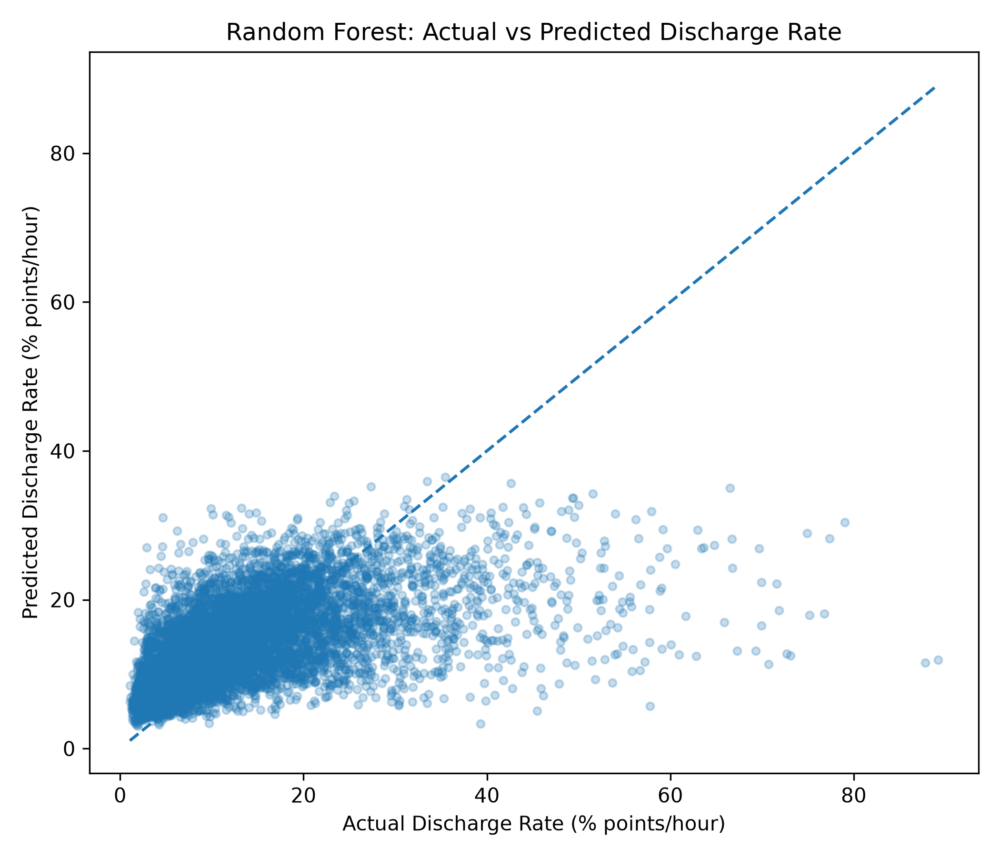
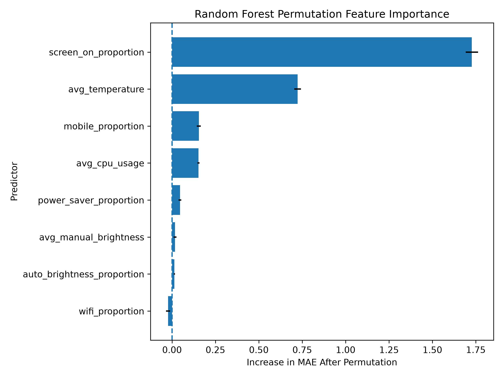

# Smartphone Battery Discharge Prediction

Machine learning analysis of smartphone battery discharge rates using real-world Android telemetry from the GreenHub dataset.

## Project Overview

This project investigates whether machine learning can estimate smartphone battery discharge rates from device operating conditions. The analysis was developed around a potential application for Samsung Electronics, where understanding battery-consumption patterns could support software optimisation, hardware testing and engineering investigations.

Three regression algorithms were evaluated:
- Linear Regression
- Random Forest
- XGBoost

The models estimate average battery discharge rates from **completed discharge sessions**, rather than forecasting future battery life in real time.

## Dataset

**Source:** [GreenHub Farmer on Kaggle](https://www.kaggle.com/datasets/hmatalonga/greenhub-farmer)

The project processed 70 Parquet files containing records from 44,115 device identifiers. A reproducible random sample of 5,000 devices was selected, producing 5,514,506 telemetry observations.

After cleaning, discharge-session construction and filtering, the final modelling dataset contained:
- **38,003 discharge sessions**
- **2,082 unique devices**
- **8 session-level predictors**

The predictors include CPU utilisation, temperature, screen activity, brightness, network connectivity and power-saving behaviour.

The raw and processed datasets are not included in this repository. They can be obtained from the original source and regenerated using the preprocessing scripts.

## Methodology

1. Sample device identifiers and retain their telemetry histories.
2. Investigate data-quality issues, missing values and unusual measurements.
3. Construct discharge sessions and calculate battery percentage points consumed per hour.
4. Engineer eight session-level features.
5. Split the dataset by device using GroupShuffleSplit to prevent device overlap.
6. Train Linear Regression, Random Forest and XGBoost.
7. Tune the ensemble models using RandomizedSearchCV with five-fold GroupKFold cross-validation.
8. Evaluate prediction accuracy, computational efficiency and feature importance.

## Model Performance

| Model | MAE | RMSE | R² |
|---|---:|---:|---:|
| Linear Regression | 6.4947 | 9.1004 | 0.2020 |
| Random Forest | 6.1542 | 8.7789 | 0.2574 |
| XGBoost | 5.9199 | 8.5118 | 0.3019 |
| **Random Forest (Tuned)** | **5.9054** | **8.4529** | **0.3116** |
| XGBoost (Tuned) | 5.9363 | 8.4731 | 0.3083 |

MAE and RMSE are measured in battery percentage points per hour.

Tuned Random Forest achieved the lowest test errors, although the difference compared with tuned XGBoost was small. XGBoost was substantially faster during hyperparameter optimisation.

## Visualisations

### Random Forest: Actual vs Predicted



### XGBoost: Actual vs Predicted


### Random Forest: Permutation Feature Importance



Screen-on proportion and average temperature were the most influential predictors in the tuned Random Forest model. Feature importance measures predictive association, not causation.

## Limitations

- The historical GreenHub dataset contains multiple Android manufacturers and does not specifically represent current Samsung devices.
- The models use features aggregated over completed discharge sessions, so they are not real-time battery-life forecasting systems.
- Some sessions were excluded because of missing telemetry, which may introduce selection bias.
- Predictive performance remained moderate, with tuned Random Forest achieving an R² of approximately 0.312.
- Both ensemble models substantially underestimated unusually high discharge rates.

These limitations mean the project is best viewed as exploratory engineering decision support rather than a deployment-ready solution.

## Repository Structure

```text
smartphone-battery-discharge-prediction/
├── README.md
├── requirements.txt
├── .gitignore
├── scripts/
│   ├── prepare_full_data.py
│   ├── analysis.py
│   ├── prepare_sessions.py
│   ├── modelling.py
│   └── analysis_results.py
└── results/
    ├── rf_actual_vs_predicted.png
    ├── xgb_actual_vs_predicted.png
    ├── rf_permutation_importance.png
    ├── rf_residual_plot.png
    └── xgb_residual_plot.png
```

## How to Run

Install the Python dependencies:

```bash
pip install -r requirements.txt
```

Download the GreenHub Farmer Parquet dataset and place the files in a `data/` directory at the repository root.

Run the main scripts from the repository root in this order:

```bash
python scripts/prepare_full_data.py
python scripts/prepare_sessions.py
python scripts/modelling.py
python scripts/analysis_results.py
```

The exploratory `scripts/analysis.py` script can be run separately to inspect an individual source Parquet file.

Model outputs and figures are saved in the `results/` directory.

## Tools and Technologies

Python, Pandas, NumPy, Scikit-learn, XGBoost, SciPy, Matplotlib and PyArrow.

## Data Source and References

- [GreenHub Farmer dataset (Kaggle)](https://www.kaggle.com/datasets/hmatalonga/greenhub-farmer)
- [GreenHub research paper](https://doi.org/10.1007/s10664-020-09925-5)
- [Random Forest — Breiman (2001)](https://doi.org/10.1023/A:1010933404324)
- [XGBoost — Chen and Guestrin (2016)](https://doi.org/10.1145/2939672.2939785)

## Project Context

Developed as part of the Principles and Practices of Data Science module in a Master of Data Science programme.
